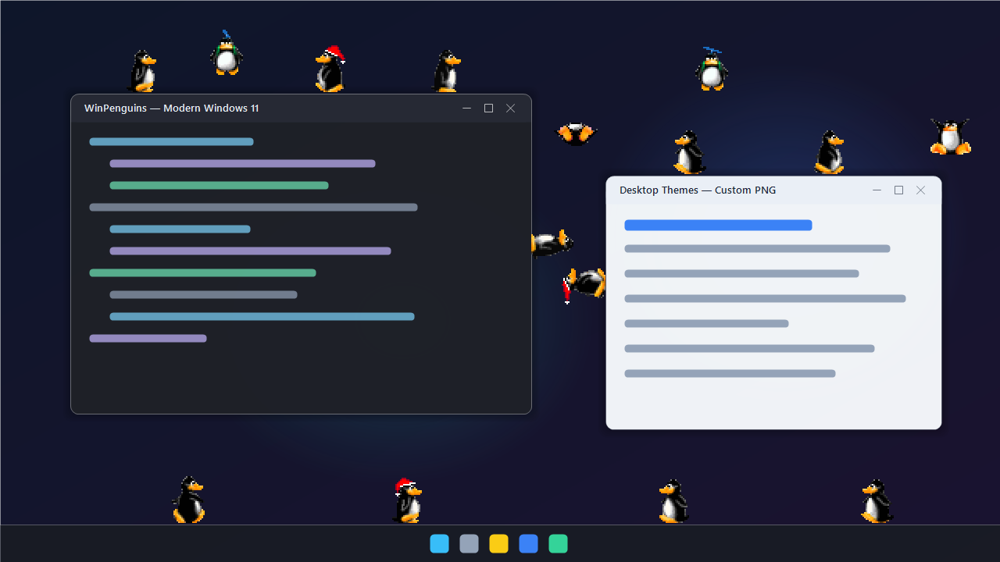

# WinPenguins (Modern Windows 11 Edition)

A modern .NET 10 / Win32 rebuild of **WinPenguins** (originally written by Michael Vines, ported from **XPenguins** by Robin Hogan, with sprites from **Pingus** by Joel Fauche).

Cute animated penguins drop onto your Windows 11 desktop, walk across window titlebars and the taskbar, climb window borders, float with umbrellas, hop when clicked, can be dragged and thrown across monitors, and scatter cleanly when dismissed.

## Screenshots




## Why the rewrite?

The original 2000–2013 C++/MFC codebase (`kasper93/winpenguins`) stopped rendering visibly on Windows 10/11 because:
- It painted directly onto the desktop `SysListView32` via `GetDC` + `BitBlt`, which is overwritten or treated as 0-alpha (invisible) under Desktop Window Manager (DWM) composition.
- It relied on `Progman -> SHELLDLL_DefView -> SysListView32`, which breaks across Windows 10/11 `WorkerW` and 24H2+ shell restructures.
- Its `Winmon.dll` global `SetWindowsHookEx` hook failed across 32-bit/64-bit process boundaries.
- Its window collision did not filter cloaked Windows 10/11 UWP/system windows (`DWMWA_CLOAKED`) or invisible DWM shadow borders (`DWMWA_EXTENDED_FRAME_BOUNDS`).

## Highlights in v2.0

- **Hardware-accelerated Direct2D + DirectComposition overlays**: `WS_EX_NOREDIRECTIONBITMAP` composition surfaces, GPU sprite sheet atlases, high-resolution waitable timer pacing (configurable 60 / 120 / 240 FPS), and pixel-crisp scaling.
- **Natural penguin physics & audio**: Per-penguin speed variation, occasional idle pauses and glances, umbrella (`Floater`) spawns and mid-air parachute saves, wired `eep.wav` / `quack.wav` action sounds, and 0–100% WAV PCM volume scaling.
- **Interactive mouse (click, grab, drag & throw)**: Click a penguin to make it hop and quack, or grab and throw it across monitors with momentum — while keeping 100% of your desktop and other windows click-through everywhere else (`WS_EX_TRANSPARENT` toggled dynamically only under hovered penguins).
- **Custom PNG themes (`theme.json`)**: Load transparent 32-bit PNG sprite packs of custom resolutions and frame counts from `%AppData%\WinPenguins\themes\` or `<AppFolder>\themes\`, with 1-click sample export in Options.
- **Windows 11 integration**: Mixed per-monitor DPI scaling (`Auto` mode queries each monitor's DPI), **Above windows** vs **Desktop only** layer modes, `DWMWA_CLOAKED` + `DWMWA_EXTENDED_FRAME_BOUNDS` collision tracking, `IsZoomed` maximized-window pass-through, per-app ignored process exclusion list, fullscreen auto-hide, Battery Saver auto-pause, and a customizable global pause/hide shortcut (`Ctrl+Alt+P` by default).

## Requirements

- Windows 10 or Windows 11 (x64)
- [.NET 10 Desktop Runtime / SDK](https://dotnet.microsoft.com/) when running from source (not required for the standalone `publish\WinPenguins.exe`)

## Build, Test & Publish

```powershell
# Build solution
dotnet build WinPenguins.slnx -c Release

# Run unit tests
dotnet test WinPenguins.slnx -c Release

# Run from source
dotnet run --project src/WinPenguins/WinPenguins.csproj -c Release

# Publish standalone single-file WinPenguins.exe to .\publish\
./publish.ps1
```

## Custom Themes (`theme.json`)

Place a folder inside `%AppData%\WinPenguins\themes\<YourTheme>\` (or use **Options -> Themes & Hotkeys -> Create Sample** to generate an editable template) containing transparent PNG sprite sheets and a `theme.json` manifest:

```json
{
  "Name": "MyCustomPack",
  "Author": "Your Name",
  "Animations": {
    "Walker": {
      "Image": "walker.png",
      "FrameCount": 8,
      "DirectionCount": 2,
      "FrameWidth": 64,
      "FrameHeight": 64,
      "Cycles": true,
      "ReverseRightRow": false
    },
    "Faller": {
      "Image": "faller.png",
      "FrameCount": 8,
      "DirectionCount": 1,
      "FrameWidth": 64,
      "FrameHeight": 64,
      "Cycles": true
    }
  }
}
```

- Supported `Animations` keys: `Faller`, `Walker`, `Climber`, `Floater`, `Tumbler`, `Bomber`, `Explosion`, `SantaWalker`, `SantaClimber`.
- For `DirectionCount: 2`, row `0` faces left and row `1` faces right (set `"ReverseRightRow": true` only if your right-facing row stores frames right-to-left).
- Any omitted animations automatically fall back to the built-in Classic sprites (and omitted `SantaWalker` / `SantaClimber` reuse your custom `Walker` / `Climber`).

## Project Layout

- `src/WinPenguins/Engine/` – Simulation loop, state machine, mixed-DPI multi-monitor & window collision physics (Win32-free, unit tested)
- `src/WinPenguins/Assets/` – Classic BMP+mask & custom 32bpp PNG sprite decoder, `theme.json` discovery/exporter, and volume-scaled WAV audio service
- `src/WinPenguins/Platform/` – Direct2D + DirectComposition per-monitor GPU overlays, dynamic hit-testing, `FramePacer`, `WindowTracker`, `GlobalHotkeyWindow`, `PowerMonitor`, screen capture
- `src/WinPenguins/Config/` – JSON settings persistence (`%AppData%\WinPenguins\settings.json`) & startup registration
- `src/WinPenguins/UI/` – System tray menu, 3-tab Options dialog, About dialog
- `tests/WinPenguins.Tests/` – xUnit tests covering physics, mouse throw, custom PNG themes, WAV PCM volume scaling, hotkeys, and settings
- `res/` – Original penguin sprite sheets, masks, icon, and sound effects (`boom.wav`, `eep.wav`, `quack.wav`)

## License

Released under the GNU General Public License v2 (`COPYING.txt`).
