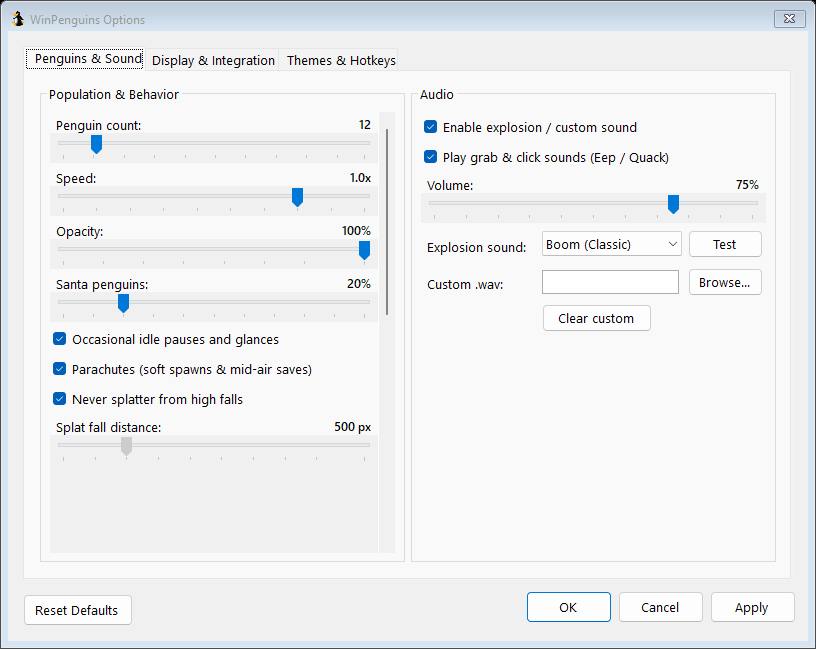

<div align="center">

# WinPenguins

**Modern .NET 10 / Direct2D rebuild of the classic desktop companions for Windows 10 & Windows 11**

[](https://github.com/FIMARx/winpenguins/actions/workflows/ci-release.yml)
[](https://github.com/FIMARx/winpenguins/releases)
[](https://github.com/FIMARx/winpenguins/releases)
[](https://dotnet.microsoft.com/)
[](COPYING.txt)

[Quick Start](#quick-start) · [Features](#features) · [Screenshots](#screenshots) · [Why the Rewrite](#why-the-rewrite) · [Custom Themes](#custom-themes) · [Build & Verification](#build-verification--diagnostics) · [License](#credits--license)

</div>

---

**WinPenguins (Modern Windows 11 Edition)** brings back the classic **XPenguins** / **WinPenguins** desktop experience (originally by Michael Vines and Robin Hogan, with sprites from **Pingus** by Joel Fauche) on top of a modern hardware-accelerated **Direct2D + DirectComposition** pipeline.

Animated penguins drop onto your monitors, stroll across window titlebars and the taskbar, scale borders, parachute down with umbrellas, chase fish snacks across monitors, bounce off trampolines, leap through twin portals, and stay 100% click-through everywhere except directly beneath an interactive penguin or toy.

---

## Screenshots

| Live Desktop Overlay | Windows 11 Fluent Options |
| :---: | :---: |
|  |  |
| *Crew roles, Desktop Toys (Fish Snack, Trampoline, Twin Portals), emotes & Let It Snow* | *5-page Fluent UI with Auto Dark/Light theme sync, Mood Presets & live preview* |

---

## Quick Start

### Option 1 — Standalone Executable (Recommended)

1. Download **`WinPenguins.exe`** (and optional **`SHA256SUMS.txt`**) from [GitHub Releases](https://github.com/FIMARx/winpenguins/releases).
2. Run it directly — it ships as a self-contained single-file `win-x64` binary with no separate `.NET` runtime required.

> [!NOTE]
> **Windows SmartScreen Notice:** Because `WinPenguins.exe` is built from source in [GitHub Actions](.github/workflows/ci-release.yml) without a paid Authenticode code-signing certificate, Windows may show *"Windows protected your PC"* on first download. Click **More info → Run anyway** (or right-click → **Properties** → **Unblock**), and optionally verify the download hash against the release's `SHA256SUMS.txt` via `(Get-FileHash .\WinPenguins.exe -Algorithm SHA256).Hash`.

### Option 2 — Run from Source

**Prerequisites:** Windows 10 or Windows 11 (`x64`) and the [.NET 10 SDK](https://dotnet.microsoft.com/).

```powershell
git clone https://github.com/FIMARx/winpenguins.git
cd winpenguins
dotnet run --project src/WinPenguins/WinPenguins.csproj -c Release
```

### Controls & Interaction

| Input | Action |
| :--- | :--- |
| **Left-click penguin** | Make it hop and chirp (`quack`) |
| **Left-drag & release** | Pick up and throw a penguin across monitors with momentum, or reposition a desktop toy |
| **Right-click penguin** | Open penguin context menu (**Feed Fish Here**, **Drop Trampoline Here**, **Change Role**, **Explode**, **Scatter All**, **Options...**) |
| **Right-click toy** | Remove that toy or **Clear All Toys** |
| **System tray icon** | Toggle **Pause**, **Walk Above Windows**, **Let It Snow**, **Dance to Music**, spawn **Desktop Toys**, capture a **Screenshot...**, or open **Options...** |
| **`Ctrl+Alt+P`** | Global pause / hide toggle (customizable under **Options → Themes & Hotkeys**) |

---

## Features

### Penguin Crew Roles

Customize the active mix in **Options → Penguins & Motion** or switch any individual penguin live via **Right-click → Change Role**:

| Role | Signature Look | Distinct Behavior |
| :--- | :--- | :--- |
| **Classic & Santa** | Classic Pingus sprites (plus optional festive Santa percentage) | Balanced walkers, window climbers, floaters, tumblers & walkers greeting each other |
| **Baby Pingu** | Compact `0.75×` scale | Flocks behind adults, chases fish snacks faster & bounces higher on click |
| **King** | Golden crown | Fearless around the cursor with royal greetings |
| **Chef** | White chef toque | Periodically serves free **Fish Snacks** onto surfaces |
| **Party DJ** | Neon headphones & sunglasses | Beat-boosted dancing speed & longer playful belly slides |
| **Jetpack Acrobat** | Jetpack & booster flames | Faster wall climbs, mid-air boosts & splat-proof landings |
| **Sleepyhead** | Cozy nightcap | Longer restful naps accompanied by floating `Zzz` emotes |

### Rendering, Physics & Windows Integration

- **Hardware-accelerated Direct2D + DirectComposition**: Per-monitor `WS_EX_NOREDIRECTIONBITMAP` composition layers, GPU sprite-sheet atlases, high-resolution waitable-timer pacing (`60` / `120` / `240` FPS), `Matrix3x2` tilt/spin/squash-and-stretch springs, soft grounded contact shadows, procedural vector emotes (`♥`, `♪`, `!`, `Zzz`), and automatic DXGI/Direct2D device-lost recovery across sleep/wake, driver updates, and monitor dock events.
- **Mixed-DPI multi-monitor collision**: `PerMonitorV2` scaling (`Auto` per monitor or fixed `1×`–`3×`), seamless roaming across monitors of different resolutions/DPI, `DWMWA_CLOAKED` + `DWMWA_EXTENDED_FRAME_BOUNDS` + `IsZoomed` window tracking, **Walk Above Windows** vs **Desktop Only** modes, and per-process exclusion filtering.
- **Interactive Desktop Toys & Snow**: Spawn, drag, and interact with **Fish Snacks**, **Trampolines**, and linked **Twin Portals** across displays, enable falling **Let It Snow** flakes that cap window titlebars and scatter underfoot, and watch penguins **Cursor Perch** on an idle mouse pointer before flinging off on a brisk mouse shake.
- **Ambient awareness & audio**: Windows WASAPI peak-meter **Dance to Music**, automatic pause/hide during fullscreen apps, Focus Assist / Presentation mode, Battery Saver, Session Lock (zero-GPU sleep), and configurable screen-recording processes (`obs64`, `streamlabs`, `bandicam`, `xsplit`), plus 0–100% WAV PCM volume scaling for built-in (`boom`, `eep`, `quack`) and custom WAV sound effects.
- **Modern Windows 11 Fluent UI**: 5-page sidebar **Options** dialog (`Penguins & Motion`, `Mouse, Toys & Snow`, `Audio & Ambient`, `Display & Monitors`, `Themes & Hotkeys`) with automatic Dark/Light theme sync, **Mood Presets** (`Chill Study`, `Winter Wonderland`, `Party Mode`, `Minimal Taskbar`), and live preview with full rollback on **Cancel**.

---

## Why the Rewrite?

The original 2000–2013 C++/MFC implementation (`kasper93/winpenguins`) breaks on modern Windows 10/11 desktops. This codebase replaces it from the ground up:

| Subsystem | Legacy C++/MFC (2000–2013) | WinPenguins Modern Edition (.NET 10) |
| :--- | :--- | :--- |
| **Desktop Drawing** | `GetDC` + `BitBlt` directly onto `SysListView32` (clipped or 0-alpha invisible under DWM) | Per-monitor **Direct2D + DirectComposition** transparent GPU overlays (`Vortice.Direct2D1`) |
| **Shell Compatibility** | Assumed legacy `Progman → SHELLDLL_DefView → SysListView32` hierarchy | Standard layered/composition child/topmost surfaces resilient across Windows 11 24H2+ |
| **Input & Hit-Testing** | Global `Winmon.dll` `SetWindowsHookEx` hook (broke across 32/64-bit apps) | Background-polled overlay hit-testing toggling `WS_EX_TRANSPARENT` only under interactive sprites |
| **Window Tracking** | Raw `GetWindowRect` (included invisible DWM shadows & cloaked UWP/system windows) | Filters `DWMWA_CLOAKED` & `IsZoomed`, uses `DWMWA_EXTENDED_FRAME_BOUNDS` + lightweight `SetWinEventHook` |
| **DPI & Refresh Rate** | Fixed `1×` sprites and low-resolution Win32 timers | `PerMonitorV2` per-monitor scaling (`Auto`–`3×`) & high-precision `60` / `120` / `240` Hz frame pacer |

---

## Custom Themes

WinPenguins ships with built-in **Classic** and **SmoothHD** (EPX/Scale2x-upscaled) themes, and supports both custom PNG packs and one-click theme imports:

- **GUI Import**: Open **Options → Themes & Hotkeys** and click **Import GIF / Aseprite...** (or drag and drop an animated `.gif` or Aseprite `.json` sprite sheet directly onto the Themes page), or click **Create Sample** to generate an editable template pack.
- **Theme Folders**: Custom theme directories are discovered automatically from `%AppData%\WinPenguins\themes\<YourTheme>\` and `<AppFolder>\themes\<YourTheme>\`.

<details>
<summary><strong><code>theme.json</code> manifest format & supported animation keys</strong></summary>

Place transparent 32-bit PNG sprite sheets alongside a `theme.json` manifest:

```json
{
  "Name": "MyCustomPack",
  "Author": "Your Name",
  "Animations": {
    "Walker": {
      "Image": "walker.png",
      "FrameCount": 8,
      "DirectionCount": 2,
      "FrameWidth": 64,
      "FrameHeight": 64,
      "Cycles": true,
      "ReverseRightRow": false
    },
    "Faller": {
      "Image": "faller.png",
      "FrameCount": 8,
      "DirectionCount": 1,
      "FrameWidth": 64,
      "FrameHeight": 64,
      "Cycles": true
    }
  }
}
```

- **Supported animation keys**: `Faller`, `Walker`, `Climber`, `Floater`, `Tumbler`, `Bomber`, `Explosion`, `SantaWalker`, `SantaClimber`.
- **Two-row sprites (`DirectionCount: 2`)**: Row `0` faces left and row `1` faces right (set `"ReverseRightRow": true` only if your right-facing row stores frames right-to-left).
- **Automatic fallbacks**: Omitted animations fall back to built-in Classic sprites; omitted `SantaWalker` / `SantaClimber` reuse your custom `Walker` / `Climber`.

</details>

---

## Build, Verification & Diagnostics

```powershell
# Build Release configuration (strict analyzers & TreatWarningsAsErrors enabled)
dotnet build WinPenguins.slnx -c Release

# Run the xUnit test suite
dotnet test WinPenguins.slnx -c Release

# Fast pre-commit check (<15 s: formatting + strict build + units + AST guards + fuzzers + About audit)
powershell -NoProfile -ExecutionPolicy Bypass -File scripts/verify.ps1 -Quick

# Full verification suite (UI layout/contrast matrix across themes & sizes, handle-leak watchdogs,
# Direct2D offscreen pixel checks, Coverlet >= 75% core coverage gate & SingleFile publish smoke test)
powershell -NoProfile -ExecutionPolicy Bypass -File scripts/verify.ps1 -Full

# Publish standalone single-file WinPenguins.exe to .\publish\
./publish.ps1
```

To enable the local git pre-commit verification hook:

```powershell
git config core.hooksPath .githooks
```

WinPenguins also includes an 8-layer automated bug-hunting pipeline, GitHub Actions CI/Release workflow ([ci-release.yml](.github/workflows/ci-release.yml)), and rolling runtime diagnostics telemetry (`%LocalAppData%\WinPenguins\diagnostics.jsonl`, copyable via **About WinPenguins → Copy Diagnostics**). See [docs/TESTING-AND-DEBUGGING.md](docs/TESTING-AND-DEBUGGING.md) for the full architecture of every check layer.

---

## Project Layout

| Path | Responsibility |
| :--- | :--- |
| `src/WinPenguins/Engine/` | Win32-free simulation loop, penguin state machine, crew roles, desktop toys, snow & multi-monitor physics |
| `src/WinPenguins/Assets/` | Classic BMP+mask & PNG decoders, `SmoothHD` upscaling, `theme.json` discovery/import/export & WAV PCM audio |
| `src/WinPenguins/Platform/` | Direct2D + DirectComposition per-monitor overlays, GPU sprite atlas, dynamic hit-testing, `FramePacer`, `WindowTracker`, ambient/power monitors & screen capture |
| `src/WinPenguins/Config/` | JSON settings persistence (`%AppData%\WinPenguins\settings.json`) & Windows startup registration |
| `src/WinPenguins/Diagnostics/` | Deduplicated exception, frame-stall & GPU-recovery telemetry (`diagnostics.jsonl`) |
| `src/WinPenguins/UI/` | System tray controller, right-click penguin/toy menus, 5-page Fluent **Options** dialog & **About** dialog |
| `tests/WinPenguins.Tests/` | Unit tests, Roslyn AST & asset contract guards, `CsCheck` fuzzers, UI layout/contrast auditor & tab crawler, GDI/USER handle-leak tests & offscreen D2D pixel verification |
| `scripts/` & `docs/` | Automated verification runner ([verify.ps1](scripts/verify.ps1)), screenshots & testing guide |
| `res/` | Original embedded sprite sheets, masks, icon & sound effects (`boom.wav`, `eep.wav`, `quack.wav`) |

---

## Credits & License

- **WinPenguins** (2000–2005) — Michael Vines & Michael Adams, with reference insights from `kasper93/winpenguins`
- **XPenguins** — Robin Hogan
- **Pingus** sprite artwork — Joel Fauche

Released under the **GNU General Public License v2** — see [COPYING.txt](COPYING.txt) for license terms and [CHANGES.txt](CHANGES.txt) for full version history.
